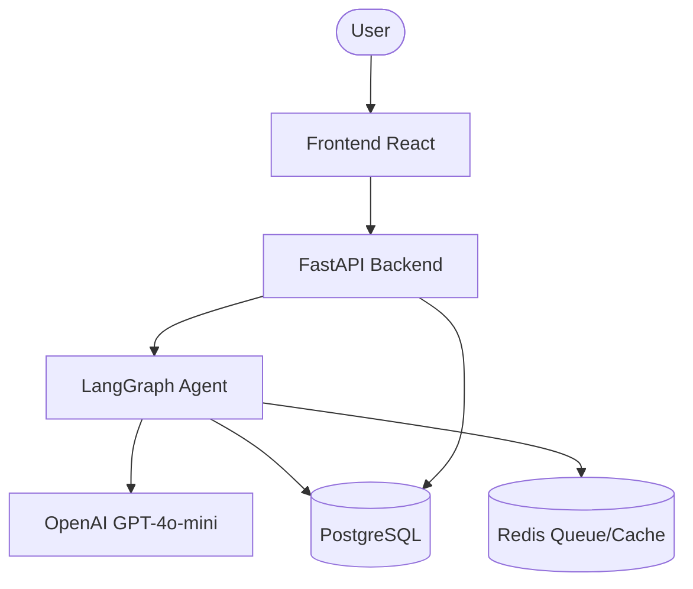
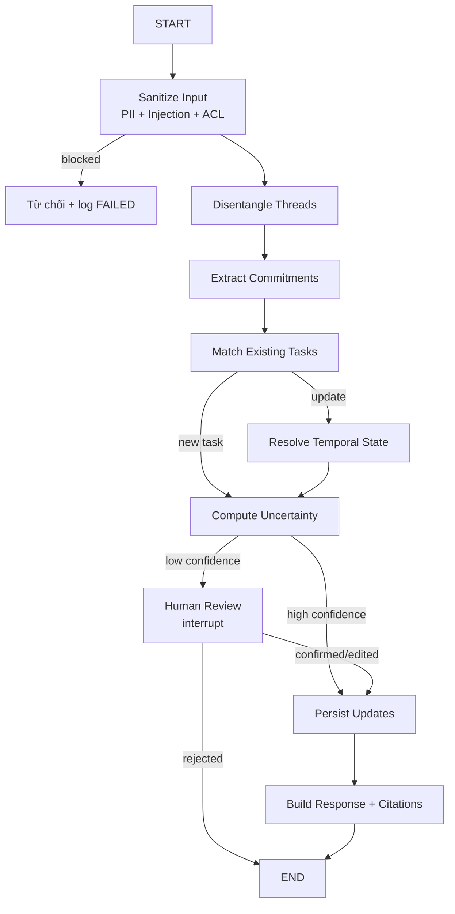

# PRD — CHAT-22 TaskMind

---

## 1. User Stories

| ID | User | Story | Acceptance Criteria |
|---|---|---|---|
| US-01 | Team Lead | Tôi muốn AI phát hiện task từ chat để không bỏ sót việc | Message có cam kết → draft task với `message_id` |
| US-02 | Member | Tôi muốn xác nhận/edit task trước khi lưu | Draft có nút Confirm / Edit / Reject |
| US-03 | Team Lead | Tôi muốn theo dõi trạng thái task theo thờii gian | Mỗi thay đổi lưu history + evidence |
| US-04 | Member | Tôi muốn nhận reminder khi cần | Reminder chỉ sau khi task được xác nhận |
| US-05 | Admin | Tôi muốn kiểm soát ai xem được dữ liệu | ACL check trước mọi read/write |
| US-06 | Team Lead | Tôi muốn thấy nguồn gốc mỗi cam kết | Task hiển thị link về tin nhắn gốc |

## 2. Functional Requirements

- **FR-01 Task Extraction:** Trích xuất `description`, `assignee`, `deadline`, `status`, `confidence`, `source_message_ids`.
- **FR-02 HITL Confirmation:** Low-confidence hoặc thiếu slot → draft cần user Confirm/Edit/Reject.
- **FR-03 Temporal State Tracking:** Detect completed / reassign / reschedule / cancellation từ tin nhắn mới.
- **FR-04 Thread Disentanglement:** Cluster messages thành thread riêng biệt.
- **FR-05 Task Inbox:** Danh sách task theo user và trạng thái.
- **FR-06 Evidence Linking:** Mọi task và state transition có `evidence_message_id`.
- **FR-07 Reminder:** Chỉ tạo khi user duyệt.
- **FR-08 ACL:** Kiểm tra quyền tại repository layer.

## 3. System Architecture



## 4. LangGraph Agent Flow



## 5. State Schema

```python
from typing import TypedDict, Annotated
from langgraph.graph.message import add_messages

class AgentState(TypedDict, total=False):
    messages: Annotated[list, add_messages]
    thread_id: str
    conversation_context: list[dict]
    disentangled_threads: list[dict]
    extracted_tasks: list[dict]
    existing_tasks: list[dict]
    pending_confirmations: list[dict]
    confirmed_updates: list[dict]
    final_response: str
    error: str
```

## 6. Nodes

| Node | File | Trách nhiệm |
|---|---|---|
| sanitize_node | `src/agents/nodes/sanitize_node.py` | PII mask, banned-pattern, ACL pre-check |
| disentangle_node | `src/agents/nodes/disentangle_node.py` | Cluster messages thành threads |
| extract_node | `src/agents/nodes/extract_node.py` | Extract task/assignee/deadline/status |
| match_node | `src/agents/nodes/match_node.py` | So khớp existing tasks |
| temporal_resolve_node | `src/agents/nodes/temporal_resolve_node.py` | Resolve state transitions |
| uncertainty_node | `src/agents/nodes/uncertainty_node.py` | Tính confidence, route HITL |
| human_review_node | `src/agents/nodes/human_review_node.py` | `interrupt()` chờ user |
| persist_node | `src/agents/nodes/persist_node.py` | Lưu DB + audit log |
| response_node | `src/agents/nodes/response_node.py` | Build response có citation |

## 7. Tools

| Tool | Chức năng |
|---|---|
| `search_task_tool` | Tìm task liên quan |
| `create_task_tool` | Tạo task mới |
| `update_task_tool` | Cập nhật trạng thái |
| `link_evidence_tool` | Liên kết evidence |
| `calendar_tool` | Tạo calendar event (approved only) |

## 8. Guardrails

**Lớp code:**
- Pydantic schema-lock cho mọi AI output.
- Banned-pattern filter.
- ACL tại repository layer.

**Lớp prompt:**
- XML structured prompts.
- SAFEGUARDS tách bạch.
- Citation contract.

## 9. Database Schema

| Table | Mục đích |
|---|---|
| `users` | Tài khoản + role |
| `teams` | Nhóm |
| `channels` | Kênh chat |
| `messages` | Tin nhắn gốc |
| `tasks` | Task hiện tại |
| `task_state_history` | Lịch sử thay đổi trạng thái |
| `task_evidence` | Liên kết task ↔ message |
| `draft_confirmations` | Draft chờ xác nhận |
| `reminders` | Nhắc việc |
| `audit_logs` | Audit log |

## 10. API Endpoints

| Method | Path | Mô tả |
|---|---|---|
| GET | `/health` | Health check |
| POST | `/api/v1/chat/ingest` | Nhận messages, trả draft tasks |
| POST | `/api/v1/chat/stream` | Stream phân tích real-time |
| GET | `/api/v1/tasks` | Danh sách task |
| GET | `/api/v1/tasks/{id}` | Chi tiết task + evidence |
| POST | `/api/v1/tasks/{id}/confirm` | Confirm/edit/reject draft |
| PATCH | `/api/v1/tasks/{id}` | Cập nhật task |
| GET | `/api/v1/tasks/inbox` | Inbox cá nhân |
| GET | `/api/v1/dashboard/summary` | Workload summary |
| GET | `/api/v1/threads/{id}` | Thread đã tách |

## 11. Evaluation Plan

**Benchmark 4-tuple:**
- **Request:** 30+ on-topic + 15 off-topic + 5 edge case từ chat thật.
- **Environment:** Agent + PostgreSQL + Redis + gpt-4o-mini.
- **Stopping criteria:** Max 8 steps, 60s timeout, $0.05/case.
- **Scorer:** Code-check + LLM-judge (judge ≠ generator) + human judge 10 case.

**Metrics:** Precision/Recall/F1, slot accuracy, state transition accuracy, thread disentanglement score, pass@k, pass^k.
