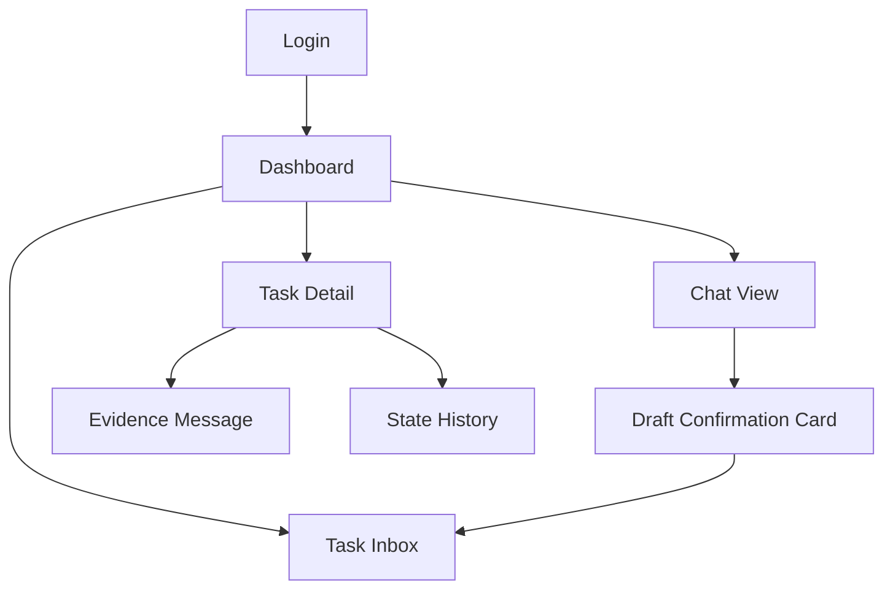

# Wireframe / UI Flow — CHAT-22 TaskMind

---

## 1. Information Architecture



## 2. Màn hình chính

### 2.1 Chat View

**Layout:**
- Left sidebar: danh sách channels / threads.
- Center: message list (user bên phải, assistant/system bên trái).
- Bottom: input box.

**Inline AI Draft Card:**
Khi AI phát hiện task, hiển thị card ngay trong luồng chat:

```
┌─────────────────────────────────────┐
│ 🤖 AI phát hiện cam kết công việc   │
│                                     │
│ 📌 Gửi proposal cho khách          │
│ 👤 Nam     📅 Mai      🟡 0.85      │
│                                     │
│ [✅ Xác nhận] [✏️ Sửa] [❌ Từ chối] │
│ Nguồn: tin nhắn #123                │
└─────────────────────────────────────┘
```

**Elements:**
- Task description.
- Assignee avatar + name.
- Deadline badge.
- Confidence score (màu theo mức độ).
- Action buttons: Confirm, Edit, Reject.
- Evidence link: "Nguồn: tin nhắn #123" → scroll đến message.

### 2.2 Task Inbox

**Tabs:**
- Cần xác nhận
- Đang làm
- Sắp hết hạn
- Hoàn thành
- Từ chối

**Mỗi row:**
- Checkbox (bulk actions).
- Task title.
- Assignee.
- Deadline.
- Status badge.
- Source channel.
- Actions: Edit / Mark done / Reschedule.

**Filters:**
- Theo tôi / team / channel / trạng thái / hạn.

### 2.3 Task Detail

**Header:**
- Title, status, assignee, deadline.
- Buttons: Edit, Mark done, Reschedule, Reject.

**Tabs:**
- **Evidence**: quote tin nhắn gốc + link.
- **History**: timeline thay đổi trạng thái.
- **Dependency graph**: (nâng cao) node graph các task liên quan.
- **Actions**: create reminder, calendar integration.

### 2.4 Dashboard

**Widgets:**
- Tổng task / % hoàn thành / % quá hạn.
- Workload chart: task per member.
- Upcoming deadlines.
- Thread disentanglement preview: phân nhóm tin nhắn theo màu.

### 2.5 Settings / Admin

- Role management: Admin, Team Lead, Member.
- Auto-confirm threshold.
- Calendar integration settings.
- Audit log viewer.

## 3. User Flow chính

### Flow A: Phát hiện task từ chat
1. User gửi message trong channel.
2. Backend nhận message → chạy LangGraph.
3. Agent: sanitize → disentangle → extract → match → uncertainty check.
4. Nếu confidence cao: hiện inline draft card trong chat.
5. User click Confirm / Edit / Reject.
6. Lưu task + audit log + evidence message.

### Flow B: Cập nhật trạng thái
1. Tin nhắn mới: *"Task proposal đã gửi rồi nhé"*.
2. Agent match với task cũ → detect completed.
3. Hiện card cập nhật → user confirm.
4. Ghi state_history với evidence_message_id.

### Flow C: Tạo reminder
1. User vào Task Detail → bật reminder.
2. Chọn thờii gian / tích hợp calendar.
3. Scheduler lưu vào Redis/DB.
4. Gửi notification đúng giờ.

## 4. Responsive & Dark Mode

- Mobile-first: chat chiếm toàn màn hình, inbox là bottom sheet.
- Dark mode: `next-themes` + Tailwind `dark:`.
- Loading skeleton cho message list và task cards.
- Error message thân thiện, không hiển thị stack trace.
